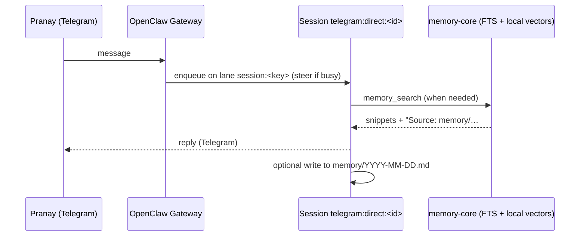
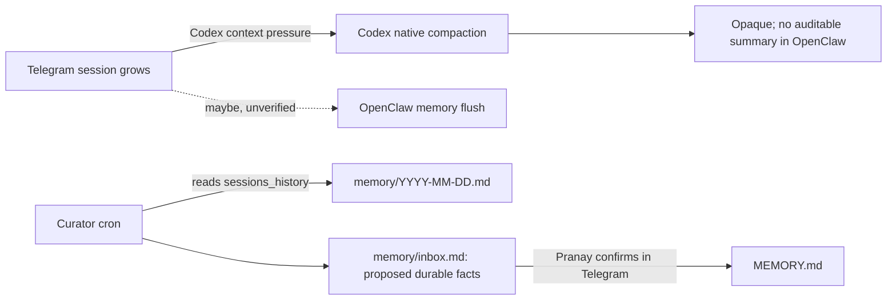
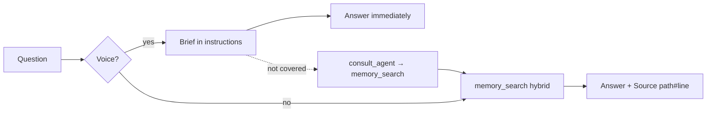

# Memory and Session Architecture for Ari (OpenClaw + Telegram + AgentRing voice)

Research date: 9 November 2026. Scope: research and design only. Nothing on the host was changed.

## How to read this document

Every important claim carries one of these labels:

| Label | Meaning |
|---|---|
| **[Docs]** | Stated in the project's official documentation at the cited version |
| **[Source]** | Read directly in source code at the cited commit or published package |
| **[Users]** | Reported by users (issues, forums), not verified in code |
| **[Inferred]** | My reasoning from the cited facts; not directly verified |
| **[Unverified]** | Secondary sources only; the primary page was unreachable from my environment |
| **[Rec]** | My recommendation |

### Pinned sources

| Artifact | Version used | Link base |
|---|---|---|
| OpenClaw upstream `main` | commit `94714fdc` (2026-11-09), `package.json` version `2026.11.1`; npm `latest` is `2026.11.2` | `https://github.com/openclaw/openclaw/blob/94714fdce8e6bd96546b5440be41fa5297d65a95/` |
| OpenClaw **installed** build | npm `openclaw@2026.7.1-2` (docs and `dist/` shipped inside the package) | `https://cdn.jsdelivr.net/npm/openclaw@2026.7.1-2/` |
| AgentRing | commit `1f811788` (2026-11-07), Apache-2.0, 94 commits since 2026-10-23 | `https://github.com/mutonby/agentring/blob/1f81178830070ad0b3d48e7f9c9be3ef32f59812/` |

Below, `OCI:` means the installed package, `OCU:` means upstream `main`, and `AR:` means AgentRing.

**Version mismatch.** The installed 2026.7.1-2 is about four months and roughly 20 releases behind upstream. Several behaviours this design depends on changed in between: defaults, storage format, backends, and config paths. Section 2.8 lists them. Unless a statement says "upstream", it refers to **the installed version**.

**Revision 2 (after review, 2026-11-09).** The architecture is unchanged. What changed:
- the rollout order: restore FTS, then **upgrade before any custom code**;
- raw transcript indexing now sits behind an explicit safety gate;
- call-transcript storage is now an opt-in privacy feature with a retention policy;
- the voice-bridge is treated as a maintained component, not a 100-line script;
- the embedder is chosen only after an on-host benchmark;
- the voice brief is smaller and tightly scoped;
- the 97 s consult is instrumented before any timeout changes.

The affected sections are §1, §5, §7–§13.

**Environment limitation.** `ai.google.dev` and `developers.openai.com` were blocked by my research sandbox's network policy. Gemini and OpenAI embedding prices and quotas are therefore marked **[Unverified]**; check them before spending money.

---

## 1. Executive verdict

1. **Don't merge voice into the Telegram session (design A).** OpenClaw runs at most one turn per session key, so voice consults would queue behind Telegram turns. The installed `openclaw agent` CLI can also return `status: "in_flight"`, and an outbound call Ari places from Telegram can deadlock against its own blocked turn ([§4](#4-architecture-comparison-designs-ad)).
2. **Adopt design C+:** a fresh OpenClaw session per call, plus a shared memory plane that both channels read and write. Telegram stays its own rolling session.
3. **Memory search is effectively off today.** The memory provider is explicitly set to OpenAI, and the installed version fails closed when an explicit remote provider errors. `memory_search` therefore returns "unavailable" instead of falling back to keyword search, and the index holds 0 chunks ([§2.4](#24-memory-search-and-embeddings-installed-version)). Fixing this is step one.
4. **Keyword search (FTS) is the floor; local embeddings are the preferred upgrade, decided by benchmark.** Benchmark the official llama.cpp provider (`provider: "local"`, EmbeddingGemma 300M, about 0.6 GB) on this host: index time, query p95, RAM, cold start, and recall gain over FTS. The installed docs say this provider falls back to keyword search when embedding fails, and nothing leaves the host. Gemini embeddings are a later option, but only with a separate paid-tier credential, never AgentRing's voice key.
5. **Markdown files are the source of truth.** `MEMORY.md` holds curated durable facts, `memory/YYYY-MM-DD.md` holds episodic notes, and a new `memory/calls/` folder holds one summary per call. These give citations (`Source: path#line`), simple deletion and correction, and grep-ability. Raw transcripts are an archive, not memory.
6. **Most personal-context questions on a call should not need a ~97 s OpenClaw consult.** Inject a small precomputed "voice brief" (800–1,200 tokens, timestamped, tightly scoped) at call start. The AgentRing library officially supports per-call `instructions` as a function of the call. Keep `consult_agent` for slow tasks. AgentRing already returns a "working on it" note after 20 s and delivers the late answer afterwards.
7. **AgentRing doesn't persist inbound call transcripts.** It keeps them in memory, and its logs record only a turn count. A "voice bridge" built on AgentRing's documented library API, in place of `agentring serve --ai`, can summarise each call into `memory/calls/` and log whether each consult completed. Treat it as a **maintained component** (several hundred lines with tests), not a script. Raw transcript capture is **opt-in, `0600`, preferably encrypted, and short-retention**; summaries outlive raw transcripts.
8. **Bridge channels with curated notes first.** Use daily notes, call summaries, and an inbox you confirm. Raw transcript retrieval (`sources: ["memory","sessions"]` plus `visibility: "agent"`) is the largest leakage risk. It is **deferred behind a gate**: `main` must provably receive no group or other-user traffic, and transcripts must be reviewed for credentials and sensitive data.
9. **Upgrade OpenClaw before building custom components,** after restoring FTS on the installed version. First pin every security-relevant default explicitly, then rehearse a snapshot rollback. Upstream later changed the omitted `tools.sessions.visibility` from `tree` to `agent` (2026.8.2) and then to `all` (2026.9.2). It also removed QMD (2026.8.1), moved transcripts to SQLite (2026.8.1), and moved `agents.defaults.memorySearch` to `memory.search`.
10. **Measure before tuning, and treat timeouts as backstops, not fixes.** Instrument the 97 s consult first. Experiments are still required (see [§12](#12-test-plan)). The open questions are: whether OpenClaw's memory flush ever fires before Codex's native compaction, where the 97 s consult time goes, and how `in_flight` and steering behave when a CLI turn targets a busy session.

---

## 2. Verified current behaviour

### 2.1 Direct-message routing; session key versus session ID

- **[Docs]** DMs share one session by default (`session.dmScope: "main"` → key `agent:main:main`). The `per-peer`, `per-channel-peer` and `per-account-channel-peer` values isolate DMs instead. `session.identityLinks` maps one person's provider identities (for example `telegram:<id>`) to a canonical peer id so their DMs share a session. — [OCI: concepts/session.md](https://cdn.jsdelivr.net/npm/openclaw@2026.7.1-2/docs/concepts/session.md), [OCI: gateway/config-agents.md](https://cdn.jsdelivr.net/npm/openclaw@2026.7.1-2/docs/gateway/config-agents.md), [OCI: channels/channel-routing.md](https://cdn.jsdelivr.net/npm/openclaw@2026.7.1-2/docs/channels/channel-routing.md)
- **[Inferred]** The observed key `agent:main:telegram:direct:1302174150` is the channel-plus-peer shape, so this deployment probably runs `dmScope: "per-channel-peer"` rather than the default. Check with `openclaw config get session` (or read `openclaw.json`).
- **[Docs]** A **session key** is the stable routing bucket for a conversation. A **session ID** (`sessionId`) is the current transcript under that key, and it changes on reset. Each row stores `sessionStartedAt` and `lastInteractionAt`. In the installed version, transcripts live at `~/.openclaw/agents/<agentId>/sessions/<sessionId>.jsonl` and the store is `sessions.json`. — [OCI: concepts/session.md §Where state lives](https://cdn.jsdelivr.net/npm/openclaw@2026.7.1-2/docs/concepts/session.md)
- **[Source]** `openclaw agent --session-id X`, when X does not exist, creates the session key `agent:<agent>:explicit:<X>`: `` `agent:${normalizeAgentId(params.agentId)}:explicit:${params.sessionId.trim()}` `` — installed `dist/session-HDnU4RDT.js:38` (inside the npm package) and upstream [`src/agents/command/session.ts:168`](https://github.com/openclaw/openclaw/blob/94714fdce8e6bd96546b5440be41fa5297d65a95/src/agents/command/session.ts#L168). Each AgentRing call therefore becomes `agent:main:explicit:agentring-call_<id>`.
- **[Docs]** `--session-key` routes to an explicit key. A bare key such as `voice` combined with `--agent main` becomes `agent:main:voice`; a fully qualified key such as `agent:main:telegram:direct:<id>` is used as given. — [OCI: cli/agent.md](https://cdn.jsdelivr.net/npm/openclaw@2026.7.1-2/docs/cli/agent.md)

### 2.2 Resets (implicit and explicit)

- **[Docs, installed]** The default is a **daily reset at 04:00 gateway-local time**, based on `sessionStartedAt`. The opt-in `idle` mode uses `idleMinutes`. `/new` and `/reset` reset manually. Heartbeat, cron and exec events do not keep a session fresh. *"Sessions with an active provider-owned CLI session are not cut by the implicit daily default."* — [OCI: concepts/session.md §Session lifecycle](https://cdn.jsdelivr.net/npm/openclaw@2026.7.1-2/docs/concepts/session.md)
- **[Docs, upstream]** The default is now `mode: "none"`, meaning no automatic reset. Reset keeps the previous transcript searchable under the same key. — [OCU: concepts/session.md §Session lifecycle](https://github.com/openclaw/openclaw/blob/94714fdce8e6bd96546b5440be41fa5297d65a95/docs/concepts/session.md)
- **[Inferred]** The Telegram session reached 68k tokens with zero compactions. Either a reset policy is configured explicitly, or the session is exempt because it is provider-owned (Codex). Confirm with `openclaw sessions --json` (compare `sessionStartedAt` with today) before relying on either assumption. **[Rec]** Set `session.reset` explicitly so behaviour does not change silently on upgrade.

### 2.3 Compaction, successor transcripts, memory flush, and Codex

- **[Docs]** Auto-compaction summarises older turns into a persisted `compaction` entry and keeps a recent tail (`keepRecentTokens`, default 20,000, for manual compaction). The full history stays on disk. With `truncateAfterCompaction: true`, a **successor transcript** is created instead of rewriting in place. Before compaction, a silent **memory-flush** turn asks the agent to write durable notes; it is controlled by `agents.defaults.compaction.memoryFlush`. — [OCI: concepts/compaction.md](https://cdn.jsdelivr.net/npm/openclaw@2026.7.1-2/docs/concepts/compaction.md)
- **[Docs]** On the **Codex harness**, *"native thread compaction belongs to Codex app-server. OpenClaw does not run preflight compaction for Codex turns … Automatic context-pressure compaction is Codex's job"*. OpenClaw also does not expose a human-readable summary of what Codex kept. — [OCI: plugins/codex-harness-runtime.md §Compaction and transcript mirror](https://cdn.jsdelivr.net/npm/openclaw@2026.7.1-2/docs/plugins/codex-harness-runtime.md)
- **[Source, upstream]** Preflight compaction returns early when `runtimeId === "codex"` or the runtime owns native compaction ([agent-runner-memory.ts:152](https://github.com/openclaw/openclaw/blob/94714fdce8e6bd96546b5440be41fa5297d65a95/src/auto-reply/reply/agent-runner-memory.ts#L152)). The memory flush is skipped when the runtime is CLI-based or owns native compaction ([agent-runner-memory.ts:554](https://github.com/openclaw/openclaw/blob/94714fdce8e6bd96546b5440be41fa5297d65a95/src/auto-reply/reply/agent-runner-memory.ts#L554)).
- **[Source, installed]** `runMemoryFlushIfNeeded` gates on `memoryFlushWritable && !params.isHeartbeat && !isCli`, where `isCli` checks CLI providers only (`dist/agent-runner.runtime-DtdxZiBX.js:3732`, `:3262`). The flush fires from OpenClaw's own token estimate.
- **[Inferred, experiment required]** If Ari runs on the native Codex harness, **don't assume the pre-compaction flush protects anything.** Upstream skips it entirely. In the installed build it may fire, but there is no evidence its threshold precedes Codex's own compaction. Either way, Codex compaction is not auditable. This is why the design below writes durable memory *deliberately* (end-of-call summaries and a daily curator) instead of relying on the flush.

### 2.4 Memory search and embeddings (installed version)

- **[Docs]** Settings live under `agents.defaults.memorySearch`. `provider` defaults to `"openai"`, and `fallback` defaults to `"none"`. — [OCI: reference/memory-config.md §Provider selection](https://cdn.jsdelivr.net/npm/openclaw@2026.7.1-2/docs/reference/memory-config.md)
- **[Docs]** *"Explicit non-local providers fail closed. If you set `memorySearch.provider` to a concrete remote-backed provider such as … Gemini … Ollama, OpenAI … and that provider is unavailable at runtime, `memory_search` returns an unavailable result instead of silently using FTS-only recall … set `provider: "none"` if you want deliberate FTS-only recall."* — same page.
- **[Inferred]** With an explicit OpenAI provider returning HTTP 429 `insufficient_quota` and 0 indexed chunks, Ari currently has **no working `memory_search` at all**, keyword search included. That would explain weak recall in both channels. The voice call still answered basic context correctly, probably because `MEMORY.md` is loaded into each fresh session at bootstrap. This is not proven.
- **[Docs]** The `local` provider requires `openclaw plugins install @openclaw/llama-cpp-provider`. Its default model is `embeddinggemma-300m-qat-Q8_0.gguf` (~0.6 GB, downloaded automatically). Gemini defaults to `gemini-embedding-001` (3072 dimensions) and also supports `gemini-embedding-2-preview`. Ollama's default embedding model is `nomic-embed-text` ([OCI: providers/ollama.md](https://cdn.jsdelivr.net/npm/openclaw@2026.7.1-2/docs/providers/ollama.md)). Changing provider, model or dimensions changes the index identity and requires `openclaw memory index --force --agent main`.
- **[Docs, upstream]** *"Leaving `provider` unset or set to `"auto"` falls back to keyword-only ranking when embedding setup or a request fails, as does `provider: "local"`."* Hybrid search combines BM25 and vectors, then applies 30-day recency decay (`MEMORY.md` never decays) and MMR to remove near-duplicates. With `memory.citations: "auto"`, snippets carry a `Source: <path#line>` footer. — [OCU: concepts/memory-search.md](https://github.com/openclaw/openclaw/blob/94714fdce8e6bd96546b5440be41fa5297d65a95/docs/concepts/memory-search.md), [OCI: reference/memory-config.md §Citations](https://cdn.jsdelivr.net/npm/openclaw@2026.7.1-2/docs/reference/memory-config.md)

### 2.5 Concurrent turns and queueing

- **[Docs]** *"`runEmbeddedAgent` enqueues by **session key** (lane `session:<key>`) to guarantee only one active run per session."* Different sessions run in parallel, up to `agents.defaults.maxConcurrent`. The inbound default is `mode: "steer"`, which **injects** a message that arrives mid-run into the active run. — [OCI: concepts/queue.md](https://cdn.jsdelivr.net/npm/openclaw@2026.7.1-2/docs/concepts/queue.md)
- **[Docs]** For `openclaw agent`: *"If the internal run-dedup key already has an active run for this session, the response reports `status: "in_flight"` and the non-JSON CLI prints a stderr diagnostic instead of an empty reply."* The CLI also *"falls back to the embedded agent if the Gateway request fails"*. If the Gateway times out, the fallback *"uses a fresh `gateway-fallback-*` session"*. — [OCI: cli/agent.md](https://cdn.jsdelivr.net/npm/openclaw@2026.7.1-2/docs/cli/agent.md)
- **[Docs]** The Codex harness reference advises *"Fork a thread before … concurrent writers for the same thread."* — [OCI: plugins/codex-harness-reference.md](https://cdn.jsdelivr.net/npm/openclaw@2026.7.1-2/docs/plugins/codex-harness-reference.md)
- **[Inferred]** Transcript corruption is unlikely, since writes are serialised per session and transcript writes take a lock ([OCI: reference/session-management-compaction.md](https://cdn.jsdelivr.net/npm/openclaw@2026.7.1-2/docs/reference/session-management-compaction.md)). The real risks are **latency** (waiting behind a turn), **an empty answer** (`in_flight`), and **context bleed**: a voice task steered into a Telegram turn could produce a Telegram reply about it.

### 2.6 Cross-session visibility and transcript search

- **[Docs, installed]** `tools.sessions.visibility` defaults to `tree` (current session plus the sessions it spawned). The other values are `self`, `agent` and `all`. *"`agent`: any session belonging to the current agent id (can include other users if you run per-sender sessions under the same agent id)."* — [OCI: gateway/config-tools.md §tools.sessions](https://cdn.jsdelivr.net/npm/openclaw@2026.7.1-2/docs/gateway/config-tools.md)
- **[Docs, installed]** Session memory search is opt-in: `experimental.sessionMemory: true` plus `sources: ["memory","sessions"]`, reindexed after `deltaBytes` 100000 or `deltaMessages` 50. *"Session transcript hits also obey `tools.sessions.visibility`. The default `tree` … To recall an unrelated same-agent gateway-dispatched session from a different session, such as a DM, intentionally widen visibility to `agent`."* With QMD, `memory.qmd.sessions.enabled: true` is also required. — [OCI: reference/memory-config.md §Session memory search](https://cdn.jsdelivr.net/npm/openclaw@2026.7.1-2/docs/reference/memory-config.md)
- **[Docs, installed]** QMD `scope` defaults to DM/direct-only, *"denying groups and other channel types"*. **[Inferred]** `explicit:` voice sessions may receive no QMD results. Test this before choosing QMD.
- **[Docs, installed]** Active Memory runs only for *"eligible interactive persistent chat sessions"*. It does **not** run for *"Headless one-shot runs"* or *"Generic internal `agent-command` paths"*, and `explicit` chat types are opt-in. — [OCI: concepts/active-memory.md](https://cdn.jsdelivr.net/npm/openclaw@2026.7.1-2/docs/concepts/active-memory.md). **[Inferred]** Active Memory will not enrich AgentRing's `openclaw agent` consults, so voice recall has to be explicit.
- **[Docs, upstream only]** `sessions_search` adds exact full-text transcript search (added in 2026.8.1, [#105057](https://github.com/openclaw/openclaw/pull/105057)), and `memory.search.rememberAcrossConversations` adds private cross-conversation recall. These do not exist in 2026.7.1. — [OCU: concepts/session-search.md](https://github.com/openclaw/openclaw/blob/94714fdce8e6bd96546b5440be41fa5297d65a95/docs/concepts/session-search.md), [OCU: concepts/session.md §Remember across conversations](https://github.com/openclaw/openclaw/blob/94714fdce8e6bd96546b5440be41fa5297d65a95/docs/concepts/session.md)

### 2.7 Retention of call sessions

- **[Docs]** `session.maintenance` defaults to `pruneAfter: "30d"` and `maxEntries: 500`. Cleanup *"prunes old unreferenced transcript, checkpoint, and trajectory artifacts"*. — [OCI: reference/session-management-compaction.md](https://cdn.jsdelivr.net/npm/openclaw@2026.7.1-2/docs/reference/session-management-compaction.md)
- **[Inferred]** Each per-call `explicit:` session stops being touched after its call ends, so its entry becomes stale after 30 days and its transcript can then be cleaned up. Raw call sessions are not a durable memory, which is another reason to write call summaries into `memory/calls/`.

### 2.8 Installed versus upstream: changes that matter

| Topic | 2026.7.1-2 (installed) | Upstream (2026.11.x) | Evidence |
|---|---|---|---|
| Memory config path | `agents.defaults.memorySearch` | `memory.search` (Doctor migrates it) | [OCU: doctor/config-migrations.md](https://github.com/openclaw/openclaw/blob/94714fdce8e6bd96546b5440be41fa5297d65a95/docs/gateway/doctor/config-migrations.md) |
| QMD backend | Available (`memory.backend: "qmd"`) | **Removed** in 2026.8.1 ("Retire QMD and use builtin memory exclusively", [#120936](https://github.com/openclaw/openclaw/pull/120936)) | [OCU: releases/2026.8.1/memory.md](https://github.com/openclaw/openclaw/blob/94714fdce8e6bd96546b5440be41fa5297d65a95/docs/releases/2026.8.1/memory.md) |
| Transcripts | JSONL + `sessions.json` | SQLite `openclaw-agent.sqlite` (2026.8.1); Doctor import | [OCU: releases/2026.8.1.md](https://github.com/openclaw/openclaw/blob/94714fdce8e6bd96546b5440be41fa5297d65a95/docs/releases/2026.8.1.md) |
| Omitted `tools.sessions.visibility` | `tree` | `agent` (2026.8.2), then **`all`** (2026.9.2), with `agentToAgent` enabled by default | [OCU: releases/2026.8.2.md](https://github.com/openclaw/openclaw/blob/94714fdce8e6bd96546b5440be41fa5297d65a95/docs/releases/2026.8.2.md), [OCU: releases/2026.9.2.md](https://github.com/openclaw/openclaw/blob/94714fdce8e6bd96546b5440be41fa5297d65a95/docs/releases/2026.9.2.md) |
| Default reset | daily 04:00 | none | §2.2 |
| Transcript full-text search | — | `sessions_search` | §2.6 |
| Cross-conversation recall | — | `rememberAcrossConversations` (via Active Memory) | §2.6 |

QMD is gone upstream, so **don't build on QMD.** Doing so would create migration debt at the next upgrade.

---

## 3. Evidence from existing implementations

### 3.1 AgentRing (read in source)

| Question | Answer | Evidence |
|---|---|---|
| Does it persist call transcripts or summaries? | **Inbound (`serve --ai`): no.** The transcript is an in-memory list. The production log records only the end reason, duration and turn count. Spoken text goes only to `DEBUG` logs ("what was said stays out of production logs"). The local SQLite store keeps relay *messages* and state, not calls. | [AR: voice/session.py:166](https://github.com/mutonby/agentring/blob/1f81178830070ad0b3d48e7f9c9be3ef32f59812/daemon/src/agentring/voice/session.py#L166), [:332](https://github.com/mutonby/agentring/blob/1f81178830070ad0b3d48e7f9c9be3ef32f59812/daemon/src/agentring/voice/session.py#L332), [AR: cli.py:782](https://github.com/mutonby/agentring/blob/1f81178830070ad0b3d48e7f9c9be3ef32f59812/daemon/src/agentring/cli.py#L782), [AR: store.py](https://github.com/mutonby/agentring/blob/1f81178830070ad0b3d48e7f9c9be3ef32f59812/daemon/src/agentring/store.py) |
| | **Outbound via the MCP `call` tool: the transcript is returned to the calling agent.** It then lands in *that* agent's OpenClaw transcript. | [AR: mcp_server.py:286](https://github.com/mutonby/agentring/blob/1f81178830070ad0b3d48e7f9c9be3ef32f59812/daemon/src/agentring/mcp_server.py#L286) |
| Stable session or user identity? | **No.** `AGENTRING_CALL_ID` is the only identity passed to agents. Open issue [#13](https://github.com/mutonby/agentring/issues/13) (2026-10-30, 0 comments) asks for exactly this ("stable conversation identifier… choose a session when calling back"), and nothing is implemented yet. | [AR: voice/agents.py:75](https://github.com/mutonby/agentring/blob/1f81178830070ad0b3d48e7f9c9be3ef32f59812/daemon/src/agentring/voice/agents.py#L75), [AR: docs/agents.md](https://github.com/mutonby/agentring/blob/1f81178830070ad0b3d48e7f9c9be3ef32f59812/docs/agents.md) |
| How does `consult_agent` behave? | It waits **20 s** (`answer_within_s=20`). If the agent hasn't answered, the tool returns "{agent} is working on it…" and the answer arrives later as an *untrusted* note. If the call has ended, the answer goes to the phone as a message (not for targeted calls). Each agent runs **one task at a time**, and a second request returns "busy". The hard per-agent `timeout_s` defaults to 600. | [AR: voice/agents.py:214, 241-262, 280-286](https://github.com/mutonby/agentring/blob/1f81178830070ad0b3d48e7f9c9be3ef32f59812/daemon/src/agentring/voice/agents.py#L214) |
| Is "I am pulling it up" proof of success? | **No.** The default prompt makes the model speak before any tool call ("say a few words first… 'let me check'"). The 20 s fallback text also tells it to say the agent is working. Proof is the daemon log line `openclaw answered: …` or `openclaw failed: …`. | [AR: voice/session.py:65-67](https://github.com/mutonby/agentring/blob/1f81178830070ad0b3d48e7f9c9be3ef32f59812/daemon/src/agentring/voice/session.py#L65), [AR: voice/agents.py:269](https://github.com/mutonby/agentring/blob/1f81178830070ad0b3d48e7f9c9be3ef32f59812/daemon/src/agentring/voice/agents.py#L269) |
| Inbound versus outbound differences | Inbound `serve --ai` has **no tool gate**, uses static `--instructions`, answers one call at a time ("already on a call; not answering") and keeps no transcript. Outbound MCP `call` gates every tool until the user has spoken (`after_user_speech`), appends the caller's `context` to the instructions, blocks the calling agent until the call ends, and returns the transcript. | [AR: cli.py:770-782](https://github.com/mutonby/agentring/blob/1f81178830070ad0b3d48e7f9c9be3ef32f59812/daemon/src/agentring/cli.py#L770), [AR: mcp_server.py:252-263](https://github.com/mutonby/agentring/blob/1f81178830070ad0b3d48e7f9c9be3ef32f59812/daemon/src/agentring/mcp_server.py#L252), [AR: docs/agents.md](https://github.com/mutonby/agentring/blob/1f81178830070ad0b3d48e7f9c9be3ef32f59812/docs/agents.md) |
| Extension point for memory | **[Docs]** The library's `instructions` can be *"a function of `CallInfo` (e.g. to add fresh context when the call starts)"*. Incoming calls are handled via `agentring.sync.run_ws` + `accept_incoming`. `VoiceAgent.run` returns a `CallResult` with `transcript` and `tools`. Gemini Live sessions end near the 15-minute limit. | [AR: docs/voice.md §As a library](https://github.com/mutonby/agentring/blob/1f81178830070ad0b3d48e7f9c9be3ef32f59812/docs/voice.md), [AR: voice/session.py:393-401](https://github.com/mutonby/agentring/blob/1f81178830070ad0b3d48e7f9c9be3ef32f59812/daemon/src/agentring/voice/session.py#L393) |
| Maturity | Created 2026-10-23, 94 commits, active (security hardening PR #21 on 2026-11-07), 305 stars and 38 forks (GitHub API, 2026-11-09). I did not inspect the forks individually. | GitHub API |

The upstream OpenClaw recipe uses `--session-id "agentring-${AGENTRING_CALL_ID}"` "so a second question on the same call keeps the context of the first" ([AR: examples/openclaw/README.md](https://github.com/mutonby/agentring/blob/1f81178830070ad0b3d48e7f9c9be3ef32f59812/examples/openclaw/README.md)). **I found no implementation, issue, PR or discussion demonstrating AgentRing with a persistent cross-call OpenClaw session.**

### 3.2 OpenClaw memory options

| Option | Relevant capability | Stores | Cross-session | Capture | Privacy / deps | Status | Fit |
|---|---|---|---|---|---|---|---|
| **memory-core (builtin)** | Hybrid BM25 + vector over `MEMORY.md` and `memory/*.md`, optionally session transcripts; citations | Markdown (truth) + SQLite index | Yes, through files; transcripts need `sessions` + visibility | Explicit writes and memory flush | Fully local with `local`/`none` | Default, bundled; upstream says builtin is now the only engine | **Core of the design** |
| **Session memory** (`experimental.sessionMemory`) | Semantic recall over transcripts | Transcript chunks | Governed by `tools.sessions.visibility` | Automatic, async, may be stale | Transcripts can contain secrets | Experimental in 7.1 and upstream | Phase 6, only after the §10 gate |
| **Active Memory plugin** | Blocking recall sub-agent before replies (`timeoutMs` example 15000; docs suggest 3000-5000 for `message` mode) | Nothing new | Yes | Automatic recall | Extra model call per turn | Bundled | Telegram only; **does not run** on the CLI path AgentRing uses |
| **QMD** | BM25 / vector / reranked query, local GGUF models (embeddinggemma ~300 MB, reranker ~640 MB, query expansion ~1.1 GB per [tobi/qmd README](https://github.com/tobi/qmd)) | Separate index | `memory.qmd.sessions.enabled` | Exports | Local | **Retired upstream** in 2026.8.1 | Avoid |
| **Honcho** (`@honcho-ai/openclaw-honcho`) | Persists every turn to a service and builds user and agent models; `honcho_search_messages`, `honcho_ask` | Raw messages, derived conclusions, user models | Yes, across channels | Automatic | External service (managed, or self-hosted with an LLM); AGPL-3.0 server ([plastic-labs/honcho](https://github.com/plastic-labs/honcho), pushed 2026-11-06) | Official doc page | Strong concept, but adds a service and LLM dependency and an opaque derived model |
| **memory-lancedb** | Vector store with auto-recall and auto-capture | Vectors and facts | Yes | Automatic | Local, plus an embedder | Official external plugin | Unnecessary at this corpus size |
| **memory-wiki** | Compiled wiki with claims, evidence and provenance | Markdown wiki | Yes | Explicit or compiled | Local | Bundled | Optional later, for provenance-heavy facts |

Sources: [OCI: concepts/memory-honcho.md](https://cdn.jsdelivr.net/npm/openclaw@2026.7.1-2/docs/concepts/memory-honcho.md), [OCI: plugins/memory-lancedb.md](https://cdn.jsdelivr.net/npm/openclaw@2026.7.1-2/docs/plugins/memory-lancedb.md), [OCI: plugins/memory-wiki.md](https://cdn.jsdelivr.net/npm/openclaw@2026.7.1-2/docs/plugins/memory-wiki.md), [OCI: concepts/active-memory.md](https://cdn.jsdelivr.net/npm/openclaw@2026.7.1-2/docs/concepts/active-memory.md), [Honcho OpenClaw guide](https://docs.honcho.dev/v3/guides/integrations/openclaw).

### 3.3 External memory systems

The repository figures below come from the GitHub API on 2026-11-09. The capability descriptions come from official docs found through search; **I did not source-inspect these projects.**

| Project | Relevant capability | Stores | Self-host and deps | Activity / licence | Lesson for this deployment |
|---|---|---|---|---|---|
| **Mem0** ([repo](https://github.com/mem0ai/mem0), [OpenClaw plugin docs](https://docs.mem0.ai/integrations/openclaw)) | LLM-extracted facts with search, update and delete; official `@mem0/openclaw-mem0` plugin where auto-recall and auto-capture are opt-in | Facts + vectors (+ optional graph) | Platform API, or OSS with your own LLM, embedder and vector DB | 68.7k stars, Apache-2.0, pushed 2026-11-06 | Extracted facts are useful, but extraction needs an LLM on every write and creates a second source of truth outside Markdown |
| **Letta / MemGPT** ([repo](https://github.com/letta-ai/letta), [docs](https://docs.letta.com)) | In-context memory blocks, archival memory, recall of raw history, sleep-time memory agents | Blocks, archival passages, messages | Docker server, Postgres, LLM | 25.4k stars, Apache-2.0, pushed 2026-10-18 | Letta *is* an agent runtime and would replace OpenClaw's loop. Its "core block plus sleep-time consolidation" pattern is what the voice brief and curator copy |
| **Zep / Graphiti** ([Graphiti](https://github.com/getzep/graphiti), [CE deprecation](https://help.getzep.com/ce-deprecation-notice)) | Temporal knowledge graph whose facts carry validity intervals; MCP server | Graph (Neo4j / FalkorDB / Kuzu) + embeddings | Graphiti self-hosts; Zep Community Edition is deprecated | Graphiti 32.7k stars, Apache-2.0, pushed 2026-11-09 | Correct a wrong memory by *invalidating* it with a date rather than deleting it. Too heavy here (graph DB plus an LLM on ingest) |
| **LangGraph** ([stores docs](https://docs.langchain.com/oss/python/langgraph/stores)) | Checkpointer for per-thread state; Store for cross-thread JSON documents by namespace, with semantic search | JSON docs + vectors | Library | 44.7k stars, MIT | Separate thread state from user-namespaced long-term memory. This deployment already has both: OpenClaw sessions and memory files |
| **LlamaIndex Memory** ([docs](https://developers.llamaindex.ai/python/framework/module_guides/deploying/agents/memory/)) | Short-term token-bounded history plus long-term blocks (`StaticMemoryBlock`, `FactExtractionMemoryBlock`, `VectorMemoryBlock`) | Messages, facts, vectors | Library | 52.9k stars, MIT | Prioritised context blocks map onto voice brief > recent episodes > search hits |
| **Qdrant** ([repo](https://github.com/qdrant/qdrant)) | Vector DB with payload filtering | Vectors | Self-host | 35.5k stars, Apache-2.0 | Filter by `user` and `channel` payload for scoping. Overkill for about 20 files |

**Nothing I found is clearly better** for this deployment than OpenClaw's builtin memory backed by Markdown files. Every external system adds a service, an LLM extraction dependency, and a second source of truth. That cuts against inspectability, easy correction and graceful degradation, for a corpus of about 20 files.

---

## 4. Architecture comparison (designs A-D)

| | **A. One canonical session** (Telegram + voice) | **B. Stable voice session + Telegram session** | **C+. Per-call session + shared memory plane** | **D. External memory service** (Honcho / Mem0 / Letta) |
|---|---|---|---|---|
| Mechanism | AgentRing runs `--session-key agent:main:telegram:direct:<id>` | `--session-key voice` → `agent:main:voice` | Keep `--session-id agentring-<call>`; add voice brief, call summaries, memory search, curator | Plugin captures every turn and serves recall |
| Continuity | Highest raw continuity | Across calls, but not Telegram | Through curated memory plus search; within a call via the call session | Automatic |
| Concurrency | **Poor.** One run per key, so voice waits behind Telegram turns. Possible `in_flight`. Steering may inject voice tasks into a Telegram turn. **Deadlock risk:** Ari's Telegram turn blocks in MCP `call` until the call ends, while that call's consult targets the same blocked session. | Low risk: `serve` takes one call at a time and consult takes one task per agent | No shared lane; calls and Telegram run in parallel | Depends on the plugin |
| Latency | Worst: every consult pays for a 68k+ token context | Grows with history | Best: small context plus a precomputed brief | Adds a recall hop |
| Transcript pollution | Voice fragments ("Task: …") mixed into Telegram history; accidental Telegram replies through steering | Contained | None | None |
| Failure blast radius | A stuck voice turn blocks Telegram | Voice only | Single call | External service outage |
| Privacy / scope | Everything in one context | Moderate | Explicit: only what you put in memory files | Data leaves for a service (or another self-hosted service) |
| Compaction | Codex native compaction on one huge session, unauditable | Same, smaller | Minimal; per-call sessions are short | n/a |
| Vendor dependence | OpenClaw only | OpenClaw only | OpenClaw only (plus a local embedder) | Additional vendor |
| Complexity | Config change only | Config change only | Moderate: a curator job, a summary step, an optional bridge | Moderate to high |
| Verdict | **Reject** | Viable fallback | **Recommended** | Defer |

Where each kind of state belongs:

| Layer | Content | Lifetime | Where |
|---|---|---|---|
| Working context | Current turns, tool state | One session | OpenClaw session (Telegram rolling; one per call) |
| Compacted summaries | Codex-owned on Codex | Session | Opaque; **don't depend on it** |
| Durable facts | Preferences, people, routines, standing instructions | Until corrected | `MEMORY.md` (curated, small, always loaded) |
| Episodic memories | "What happened / what was decided" per day or call | Months, with decay | `memory/YYYY-MM-DD.md`, `memory/calls/*.md` |
| Tool state | Reminders, calendar | Owned by the tools | Their own stores; never copied into memory |
| Transcript archive | Raw turns | 30-day pruning by default | OpenClaw sessions; searchable only with explicit visibility |
| Voice brief | Compact, sanitised digest | Regenerated, disposable | `~/.openclaw/workspace/voice/brief.md` (derived) |

---

## 5. Recommended architecture (C+)

```text
                ┌──────────────────────── Ubuntu host (Tailscale only) ────────────────────────┐
 Telegram ────► │ OpenClaw Gateway ── agent "main" (Ari), DM-only                               │
                │   session agent:main:telegram:direct:<id>   (rolling; Codex runtime)          │
                │   sessions agent:main:explicit:agentring-<call>   (one per call)              │
                │   cron "memory-curator"   (fresh session per run)                             │
                │                                                                               │
                │ Memory plane (workspace)                                                      │
                │   MEMORY.md (curated facts)   memory/YYYY-MM-DD.md   memory/calls/*.md        │
                │   voice/brief.md (derived, sanitised)                                          │
                │   memory-core index (SQLite: FTS5 + vectors from local llama.cpp embedder)    │
                │                                                                               │
                │ voice-bridge (user systemd; replaces `agentring serve --ai`)                   │
                │   per-call instructions = base prompt + voice/brief.md                         │
                │   consult_agent → `openclaw agent --session-id agentring-<call>` (timeout 120 s)│
                │   on call end: transcript → private spool → summarise into memory/calls/       │
                │ AgentRing relay + LiveKit (Docker, unchanged)                                  │
                └───────────────────────────────────────────────────────────────────────────────┘
 Android (AgentRing app) ◄── LiveKit audio ──► Gemini Live (Google cloud)
```

### Components and responsibilities

1. **Telegram session (unchanged).** Ari's main text conversation. It writes durable facts to `MEMORY.md` when asked or when the agent judges them durable, per the agent instructions. It writes episodic notes to the day's `memory/YYYY-MM-DD.md`.
2. **Per-call OpenClaw sessions (unchanged command, shorter timeout).** Within-call continuity for multiple consults. These are disposable.
3. **Memory plane.** Markdown files are authoritative. The builtin index is derived and can be rebuilt (`openclaw memory index --force --agent main`).
4. **Embedder.** `@openclaw/llama-cpp-provider` with EmbeddingGemma 300M, running locally. If it fails, recall continues as keyword-only (FTS), per the docs.
5. **Memory curator.** An OpenClaw cron job, which runs a fresh session per run ([OCI: concepts/session.md](https://cdn.jsdelivr.net/npm/openclaw@2026.7.1-2/docs/concepts/session.md)), every few hours plus nightly. It:
   - reads `memory/YYYY-MM-DD.md` (written by the Telegram session itself, per the agent instructions) and recent `memory/calls/*`. Reading Telegram history directly with `sessions_history` needs `visibility: "agent"` and waits for the §10 gate;
   - appends episodic notes;
   - *proposes* durable facts. It doesn't silently rewrite `MEMORY.md`: it writes a `memory/inbox.md` list that Pranay confirms from Telegram;
   - regenerates `voice/brief.md` according to §5.3, only when the inputs have changed meaningfully.
6. **voice-bridge.** A maintained Python component using AgentRing's documented library API: `VoiceAgent`, `Consultations`, `load_agents`, `accept_incoming`, `run_ws`. The happy path is about 100 lines. Expect several hundred with the requirements in §5.1, and pin the AgentRing version it is tested against. It:
   - builds instructions per call from the brief, so personal questions need no consult;
   - logs consult start and end and the outcome, which proves completion;
   - after each call, if transcript capture is enabled (§5.2), writes the `CallResult` transcript to the spool and runs one `openclaw agent --session-id agentring-<call>` turn: "summarise this call into `memory/calls/<date>-<call>.md` with provenance". If capture is off, it summarises only the consult questions and answers already in the call's OpenClaw session.
   - **No-code fallback:** keep `agentring serve --ai --instructions @<static file>`, and have the curator also restart the service when the brief changes. Static instructions are read only at startup ([AR: voice/quick.py](https://github.com/mutonby/agentring/blob/1f81178830070ad0b3d48e7f9c9be3ef32f59812/daemon/src/agentring/voice/quick.py)). This loses inbound transcript capture.

### 5.1 voice-bridge engineering requirements

| Concern | Requirement |
|---|---|
| Cancellation | Hang-up cancels the pending speech, but **not** in-flight consults. Late answers follow AgentRing's existing "deliver as message" path. A consult still running at shutdown is killed after a grace period and logged as `abandoned`. |
| Late answers | Record each consult's terminal state (`answered`, `failed`, `timeout`, `abandoned`) with its duration. Never mark a consult answered from model speech. |
| Retries | No automatic retry of consults (they can have side effects). Retry only the post-call summary step, which is idempotent: keyed by call ID, it skips if the summary file exists. |
| Atomic writes | Write to a temp file, `fsync`, then `rename` for summaries and the brief. Never leave a half-written Markdown file to be indexed. |
| Shutdown | On SIGTERM, refuse new calls, let the active call finish up to a bound, flush pending summaries, then exit. Restarts must never drop an active call (restarts triggered by brief regeneration are gated on "no active call"). |
| Logging | Structured logs containing call ID, consult ID, timings and outcome only. **No transcript text in logs**, matching AgentRing's own policy. |
| Upgrades | Pin the `agentring` version; run a contract test (incoming-call accept, consult, `CallResult` shape) before any bump. |
| Tests | Unit tests for policy and file handling; one end-to-end test with AgentRing's echo / local provider where available; a manual call checklist (§12). |

### 5.2 Call-transcript retention policy (privacy feature)

Calls can contain other people's voices and sensitive material, so raw capture is governed by an explicit policy:

- **Off by default.** A config switch turns it on. When off, only consult questions and answers (already in OpenClaw) are summarised.
- **Storage.** A dedicated spool directory with mode `0700` and files `0600`, owned by the service user. Preferably encrypted at rest: an encrypted home or volume, or per-file encryption with a key outside the workspace. Never inside the OpenClaw workspace, so it is never indexed by memory search.
- **Retention.** Short and fixed, for example 72 hours or at most 7 days. A daily timer deletes files past retention. Deletion is logged by call ID only.
- **Summaries outlive transcripts.** A summary records `raw_transcript: deleted <date>` in its front matter, so provenance stays honest.
- **Third parties.** Summaries describe what Pranay said and decided. Other people's statements are reduced to what is needed (for example "spoke with the plumber; appointment Thursday").
- **Manual purge.** A single command deletes the spool and, optionally, a given call's summary, followed by a reindex.

### 5.3 Voice brief scope

- **Size:** 800–1,200 tokens. Keep it small so the instructions stay focused and cheap.
- **Header:** `Generated: <ISO timestamp>; sources: MEMORY.md@<mtime>, memory/<files>`.
- **Includes:** how to address Pranay, language and style, current routines and near-term plans, open threads from the last few days, and standing preferences needed for ordinary conversation.
- **Excludes:** credentials, tokens and IDs; financial amounts and account details; health and legal details; third parties' private data; anything not needed for ordinary conversation. For any of these, the voice model must use `consult_agent`.
- **Regeneration:** when the inputs change meaningfully (new confirmed fact, new call summary, new day's episodic note), not on a blind interval. Add a daily floor so the timestamp never goes stale.

### Trust boundaries

| Boundary | Rule |
|---|---|
| Host ↔ Google (Gemini Live) | The brief and live audio go to Google; that is already true for the call itself. **The brief excludes** financial data, credentials, device or pairing IDs, health or legal details, and third parties' private data. The voice model acts on what it hears ([AR: docs/agents.md](https://github.com/mutonby/agentring/blob/1f81178830070ad0b3d48e7f9c9be3ef32f59812/docs/agents.md)), so `consult_agent` must remain read-mostly with OpenClaw approvals intact. |
| Consult answers → voice model | Already marked `trusted=False` by AgentRing. |
| Session visibility | `agent` scope is safe only while agent `main` is a **single-user, DM-only** agent. Enforce this with a Telegram allowlist / pairing for DMs, no group bindings to `main`, and a separate agent (with its own workspace) for any group or other-person work. Run `openclaw security audit` after changes. |
| Identity linking | **[Rec]** Don't use `session.identityLinks` for voice. It applies to *channel peers*, and the AgentRing CLI path is not a channel peer. The canonical user is implicit: the single owner of agent `main`. If more people ever use the phone or Telegram bot, give them their own agent rather than linking identities. |
| Credentials | Embeddings are local, so no key is needed. If Gemini embeddings are adopted later, use a separate key in a separate Google project (with its own quotas and blast radius), stored through OpenClaw's secret mechanism. Never reuse AgentRing's `GEMINI_API_KEY`, and never put a key in `agents.yaml`. |
| Network | Nothing new is exposed. The gateway HTTP API, if used, stays on loopback ([OCI: gateway/openai-http-api.md](https://cdn.jsdelivr.net/npm/openclaw@2026.7.1-2/docs/gateway/openai-http-api.md): "Keep it on loopback/tailnet/private ingress only"). |

---

## 6. Data-flow diagrams

### 6.1 Telegram turn



### 6.2 Inbound voice call (Pranay taps "Call agent")

```mermaid
sequenceDiagram
  participant A as Android app
  participant R as Relay + LiveKit
  participant B as voice-bridge
  participant L as Gemini Live
  participant O as openclaw agent (agentring-<call>)
  A->>R: call.invite (user_to_agent)
  R->>B: event via run_ws
  B->>B: accept_incoming; instructions = base + voice/brief.md
  B->>L: connect(instructions, tools)
  L-->>A: greeting (≤1 s after answer)
  Note over L: personal context answered from brief (0 s lookup)
  L->>B: consult_agent(openclaw, task)   [only for actions or deep lookups]
  B->>O: spawn (timeout 120 s)
  alt answer < 20 s
    O-->>B: stdout
    B-->>L: tool result
  else
    B-->>L: "working on it" (spoken)
    O-->>B: late answer → notify(trusted=False)
  end
  A->>R: hang up
  B->>B: CallResult.transcript → spool (0600)
  B->>O: "summarise into memory/calls/<date>-<call>.md"
```

### 6.3 Outbound voice call (Ari calls Pranay from Telegram)

```mermaid
sequenceDiagram
  participant S as Telegram session (Ari)
  participant MCP as agentring mcp (stdio)
  participant L as Gemini Live
  participant O as openclaw agent (agentring-<call>)
  S->>MCP: call(reason, context)   [Telegram turn now BLOCKED]
  MCP->>L: instructions = default + context; tools gated until user speaks
  L->>O: consult_agent (new explicit session; NOT the blocked Telegram key)
  O-->>L: answer
  MCP-->>S: transcript, duration, tools used
  S->>S: write summary to memory/calls/… (transcript is in this session already)
```

Under design A, the consult in 6.3 would target the blocked Telegram session key. **[Inferred]** That wait would last until the call ended or the consult timed out.

### 6.4 Compaction (Telegram, Codex runtime)



### 6.5 Memory write with provenance

```mermaid
flowchart TD
  src[Telegram turn / call summary / curator] --> w[Append entry]
  w --> f["memory/…md entry: date, source=session key or call id, confidence, supersedes=…"]
  f --> idx[memory-core reindex (watch/debounce)]
  idx --> fts[FTS5]
  idx --> vec[local embeddings; if down → keyword only]
```

### 6.6 Later recall (either channel)



---

## 7. Embedding strategy

**In plain language:** an embedding turns a piece of text into a list of numbers, so that texts with similar meaning end up close together. "Where do I park at work?" can then find a note that says "office garage, level 2" even though they share no words. Keyword (BM25/FTS) search finds exact words; it is extremely reliable for names, IDs and error strings, but it misses paraphrases. Hybrid search runs both and merges the results.

| Option | Quality | Latency (query) | Size / RAM | Cost | Privacy / offline | Failure mode in 7.1 |
|---|---|---|---|---|---|---|
| **OpenAI `text-embedding-3-small`** (after adding credit) | Good | Network round trip, roughly 100-400 ms **[Inferred]** | none | ~$0.02 / 1M tokens **[Unverified]** ([model page](https://developers.openai.com/api/docs/models/text-embedding-3-small)); pennies at this corpus size | Text leaves the host | **Fails closed:** memory unavailable when quota or network fails |
| **Gemini** `gemini-embedding-001` (OpenClaw default) / `gemini-embedding-2-preview` | Good; multimodal for `extraPaths` | Network | none | Paid ~$0.15 (001) / ~$0.20 (2) per 1M text tokens; free tier exists, with users reporting 429s **[Unverified]** ([pricing](https://ai.google.dev/gemini-api/docs/pricing), [forum](https://discuss.ai.google.dev/t/constant-429-resource-exhausted-error-after-switching-to-the-more-recent-text-embedding-model-gemini-embedding-001-on-free-tier/107614)) | Text leaves the host; check free-tier data-use terms | Fails closed |
| **Ollama** (`nomic-embed-text` default) | Good | Local, CPU tens of ms **[Inferred]** | Ollama daemon + model | Free | Local, offline | Listed as an explicit provider, so it **fails closed** if the daemon is down |
| **Managed local** (`provider: "local"`, EmbeddingGemma 300M Q8, ~0.6 GB) | Good for short notes | Local, CPU tens of ms **[Inferred]** | ~0.6 GB disk, modest RAM | Free | Local, offline | **Falls back to keyword** per the docs |
| **QMD** BM25 / `vsearch` / `query` + rerank | Best of these (rerank + expansion) | `query` loads up to ~2 GB of models; ~1 s re-create after 5 min idle per the QMD README | ~2 GB of models | Free | Local | Retired upstream: migration debt |
| **FTS-only** (`provider: "none"`) | Exact terms only | Under 10 ms | none | Free | Local | Deterministic; never "unavailable" |

**[Rec]**
1. **Now:** set `provider: "none"` and reindex. This restores keyword recall within minutes and removes the fail-closed outage.
2. **Next (after the upgrade):** benchmark `provider: "local"` (llama.cpp EmbeddingGemma) on this host: full index time, query p50/p95 warm and cold, resident RAM, cold start after idle, and recall gain over the FTS baseline on the §12 question set. The latency column above is **[Inferred]** until measured. Adopt it if recall improves within budget. It degrades to keyword search on failure, which makes it the preferred semantic option. Otherwise FTS-only is an acceptable end state.
3. **Optional later:** Gemini, with a dedicated paid-tier key, only if recall tests show local quality is insufficient. Test whether `fallback: "local"` behaves as hoped before relying on it, because explicit remote providers fail closed.

**Latency budget for realtime voice:**
- first audible acknowledgement: 1 s or less after the user stops speaking (Gemini Live's job; the AgentRing prompt already forces a filler line);
- personal-fact answers from the brief: 0 s of extra lookup;
- local memory lookup, if exposed as a fast tool: 0.5 s or less;
- `consult_agent`: spoken status at 20 s (AgentRing's built-in limit), hard cap at 120 s;
- no silence longer than about 3 s without a status line.

Embedding choice barely matters for latency because search runs inside a consult. What matters is avoiding consults in the first place.

---

## 8. Memory strategy

| Layer | Writer | Format and provenance | Correction / deletion |
|---|---|---|---|
| **Working context** | OpenClaw | Session transcript | `/new` (Telegram); call sessions are disposable |
| **Durable facts** (`MEMORY.md`) | Pranay-confirmed only (from `memory/inbox.md`) | `- <fact> — since 2026-11-09 (src: telegram 2026-11-09 / call <id>)` | Edit the line; write corrections as `~~old~~ → new (corrected 2026-…)` for an audit trail, then reindex |
| **Episodic** (`memory/YYYY-MM-DD.md`, `memory/calls/YYYY-MM-DD-<call>.md`) | Telegram session, curator, voice-bridge summary step | Front matter: `source`, `session_key`, `call_id`, `channel`, `created`, `confidence`; dated files decay with a 30-day half-life (upstream docs) | Delete the file or entry, then `openclaw memory index --force --agent main` |
| **Transcript archive** | OpenClaw | JSONL (7.1) / SQLite (8.1+) | `openclaw sessions cleanup`; pruned after 30 days by default (§2.7) |
| **Embeddings** | memory-core | Derived; never authoritative | Rebuild at any time |
| **Keyword fallback** | memory-core FTS5 | Always on | — |
| **Voice brief** | Curator | Derived, sanitised, 800–1,200 tokens, timestamped header, scoped per §5.3 | Regenerated; never edited by hand |

Rules:
- **Never auto-promote** facts extracted from voice into `MEMORY.md`. Speech-to-text errors and model paraphrase are the main source of wrong memories.
- **Raw call transcripts** are opt-in, follow §5.2, and are never stored in the indexed workspace. Only the summary remains after retention.
- The **agent instructions** (in `AGENTS.md` / `SOUL.md` in the workspace) should require citing `Source:` paths when answering from memory and saying "I don't have that" instead of guessing.

---

## 9. Latency design

1. **Instrument the 97 s before changing any timeout.** A cap hides the problem; fixing the cause removes it. Record each component separately:
   - CLI process start until the request is sent;
   - transport (`meta.transport` gateway versus `embedded` fallback, from `--json`);
   - gateway queue wait;
   - model time, split into reasoning and output;
   - each tool call's duration, especially `memory_search` failures and retries;
   - process exit.

   Candidate causes, all **[Inferred]**:
   - CLI cold start and plugin preload for each `openclaw agent` process;
   - an embedded fallback after a gateway failure (`--json` shows `meta.transport: "embedded"`);
   - Codex turn latency with reasoning;
   - a failing `memory_search` call (the fail-closed OpenAI provider) followed by agent retries.

   Measure with `time openclaw agent --agent main --session-id probe-$(date +%s) --message "What city do I live in?" --json`, then repeat with `--thinking low`.
2. **Acknowledgement.** Keep AgentRing's `before_tools` prompt (filler before tools).
3. **Streaming status.** AgentRing's 20 s "working on it" note already exists, so don't lower it below about 10 s. Optionally add a 45 s "still checking" note in the voice-bridge.
4. **Timeouts (after instrumentation, as a backstop).** Set `timeout_s: 120` in `agents.yaml` and pass `--timeout 110` to `openclaw agent`, so OpenClaw stops first and the result is clean. Wrap the command in `timeout -k 10 115` as the docs advise for external wrappers.
5. **Cancellation.** If the user hangs up, AgentRing still delivers the late answer as a phone message (inbound, untargeted calls). Keep that behaviour, because it is the "partial results" path.
6. **Retries.** Don't auto-retry consults (side effects). Retry only on `in_flight` (which shouldn't happen with per-call sessions).
7. **Caching.** The voice brief *is* the cache. Regenerate it every 2-4 hours and after notable Telegram activity.
8. **Cheaper consult turns.** Consider `--thinking low` for voice consults. A dedicated faster model via `--model` is an option, but only after quality tests.

---

## 10. Cross-session transcript retrieval and security

| Setting (7.1) | Exact semantics (docs) | Recommendation |
|---|---|---|
| `agents.defaults.memorySearch.experimental.sessionMemory` (`memory.search…` after upgrade) | Opt-in transcript indexing; async; may be stale | **Deferred** (Phase 6 gate) |
| `agents.defaults.memorySearch.sources: ["memory","sessions"]` | Adds transcripts to `memory_search` | **Deferred** (Phase 6 gate) |
| `tools.sessions.visibility: "agent"` | Session tools and transcript hits may reach **any session of agent `main`**, including other users' if per-sender sessions exist under it | Keep explicit `"tree"` until the gate passes |
| `memory.qmd.sessions.enabled` | Exports transcripts into QMD (QMD backend only) | Don't use (QMD retired upstream) |

**Leak paths if this is done carelessly:**
- a group chat routed to `main`;
- a second person DMing the bot (per-channel-peer sessions under the same agent);
- a future agent sharing the workspace;
- a voice caller who isn't Pranay (anyone holding the paired phone).

**Mitigations:**
- keep DM access allowlisted and paired;
- no group bindings on `main`;
- a separate agent with its own workspace for any shared or group use;
- `openclaw security audit`;
- a sanitised voice brief;
- excluding secrets from memory files. Transcript search excerpts preserve credentials, per upstream [session-search.md](https://github.com/openclaw/openclaw/blob/94714fdce8e6bd96546b5440be41fa5297d65a95/docs/concepts/session-search.md).

**Gate checklist before enabling raw transcript retrieval (all must pass):**
1. `openclaw sessions --all-agents --json` shows agent `main` holding only Pranay's Telegram DM, its own `explicit:agentring-*` sessions, and cron sessions; no group, channel or other-peer keys.
2. The config proves it stays that way: DM allowlist / pairing for Telegram, no bindings that route groups or other peers to `main`, and any group or shared use bound to a different agent with its own workspace.
3. `openclaw security audit` is clean.
4. A credential and sensitive-data sweep of `main`'s transcripts. Grep for key and token patterns, pairing codes and financial details. Handle any hits by deleting or compacting those sessions, or by not enabling.
5. Curated notes and call summaries have been in use for at least two weeks, and the recall tests show a concrete gap that only transcripts would fill.

**Upgrade warning:** set `tools.sessions.visibility` and `tools.agentToAgent.enabled` **explicitly** before upgrading past 2026.9.2. Otherwise an omitted value becomes `all` with agent-to-agent access on.

**Canonical user ID:** for a single user, the agent *is* the user boundary, so merging channels into one session is unnecessary. Retrieval is unified through the memory plane instead. `identityLinks` safely unifies *DM routing* for linked channel peers only, and is not needed here.

---

## 11. Migration plan

All steps are **[Rec]**. Revision 2 changes the order: restore keyword recall on the installed version, **then upgrade OpenClaw**, and only then build custom components. Building the curator and voice-bridge on 2026.7 would have to be redone, because config paths, transcript storage, QMD and visibility defaults all change after 2026.7 (§2.8). Validate between phases. Each phase has its own rollback.

**Phase 0: backup and baseline (no behaviour change).**
1. Snapshot to a local, encrypted location, never off the tailnet:
   - `~/.openclaw/` (config, workspace, agents/sessions);
   - `~/.agentring/` (`agents.yaml`, `.env`, pairing state; keep `0600`);
   - the AgentRing relay and LiveKit Docker volumes (tar of named volumes). **Don't recreate the containers.**
2. Record the current state:
   - `openclaw --version`;
   - `openclaw memory status --deep --agent main`;
   - `openclaw sessions --json`, to note the Telegram session key and ID;
   - the effective `session` and `tools.sessions` config;
   - `systemctl --user status` for the AgentRing unit.
3. Don't run `agentring init` or `agentring pair` again, and don't touch Firebase or device tokens.
4. **Instrument the consult before changing anything** (§9.1). Record a baseline p50/p95 and its breakdown.

**Phase 1: restore recall on 2026.7.1-2 (minutes).**
1. Set `agents.defaults.memorySearch.provider: "none"`.
2. Run `openclaw memory index --force --agent main`, then `openclaw memory status --deep --agent main`. Expect about 20 files and more than 0 chunks, in FTS-only mode.
3. Run the recall baseline (§12, test 1) to get the FTS-only score.
4. Rollback: restore `openclaw.json` and restart the gateway.

**Phase 2: upgrade OpenClaw, with tested rollback.**
1. Before upgrading, pin every security-relevant default **explicitly** in config:
   - `tools.sessions.visibility: "tree"` (keep today's behaviour; widen later only through the Phase 6 gate);
   - `tools.agentToAgent.enabled: false`;
   - `session.dmScope` and `session.reset` (the upstream reset default changed from daily to none).
2. Read the 2026.8.1, 2026.8.2 and 2026.9.2 release notes, plus the notes for the target version.
3. **Rehearse the rollback first:** restore the Phase 0 snapshot onto a scratch copy and confirm the old binary starts on it. Upstream warns that newer database formats are not readable by older binaries ([OCU: concepts/session.md §Creators and assigned owners](https://github.com/openclaw/openclaw/blob/94714fdce8e6bd96546b5440be41fa5297d65a95/docs/concepts/session.md)), so rollback means restoring the snapshot, not downgrading in place.
4. Stop the gateway and run the upgrade. Then run `openclaw doctor --fix`, which migrates `memorySearch` → `memory.search` and JSONL / `sessions.json` → SQLite. Validate with `openclaw doctor --session-sqlite inspect --session-sqlite-all-agents`.
5. Re-check that visibility, agent-to-agent, DM scope and reset are still explicit. Run `openclaw security audit`.
6. Re-run Phase 1's recall baseline and an AgentRing smoke test (`agentring agents ask openclaw "…"`, then one real call). Tests 1, 7 and 12 in §12 must pass.
7. Rollback: stop the gateway, restore the Phase 0 snapshot, reinstall `openclaw@2026.7.1-2`, and start it.

**Phase 3: benchmark, then choose the embedder.**
1. Install `@openclaw/llama-cpp-provider`, and **benchmark before switching**:
   - full index time;
   - query p50/p95 (warm and cold);
   - resident RAM;
   - cold start after an idle period;
   - recall score against the FTS-only baseline.
2. Switch only if recall improves meaningfully and query p95 stays well inside the consult budget. Otherwise stay on FTS-only, which is a legitimate end state for a corpus this size.
3. Prove the degradation path: stop the embedder and confirm that keyword hits still come back.
4. Rollback: `provider: "none"`, then reindex.

**Phase 4: curated bridge between channels.**
1. Create `memory/calls/`, `memory/inbox.md` and `voice/brief.md` (§8).
2. Add the curator cron job. Under `visibility: "tree"` it can't read the Telegram session. So in this phase the curator works from memory files only, and the Telegram session writes its own episodic notes, as required by the agent instructions.
3. Add the provenance, citation and "don't guess" rules to `AGENTS.md`.
4. Start the voice brief through the no-code path: a static `--instructions @file` plus a service restart when the brief changes. Gate the restart so it never interrupts an active call.

**Phase 5: voice-bridge (maintained component).**
1. Build it to the requirements in §5.1, with tests. Install it as a separate user unit, disabled.
2. Enable call-transcript capture only under the policy in §5.2, with its own on/off switch.
3. Switch over by stopping `agentring serve --ai` and starting the bridge. Rollback is the reverse; `agents.yaml` and pairing are unchanged.
4. Set consult timeouts from the Phase 0 measurements (§9), not before.

**Phase 6 (gated, optional): raw transcript retrieval.**
Enable `sources: ["memory","sessions"]` and session-memory indexing, and widen `tools.sessions.visibility` to `"agent"`, **only if every item in the §10 gate checklist passes.** Rollback: return visibility to `"tree"`, remove `"sessions"` from `sources`, and reindex.

---

## 12. Test plan

| # | Test | Method | Pass criterion |
|---|---|---|---|
| 1 | **Recall accuracy** | 30 questions with known answers (10 exact-term, 10 paraphrase, 10 temporal "what did we decide last Tuesday"), asked in Telegram and by voice | ≥90% exact, ≥80% paraphrase (local embeddings), each answer cites `Source:`; record FTS-only as the baseline |
| 2 | **Wrong-memory correction** | Plant a false fact, correct it in Telegram, then ask by voice after the brief regenerates | Old fact never asserted; correction visible in the file history |
| 3 | **Cross-channel continuity** | Tell Ari something in Telegram, call within 5 min and after brief regeneration; reverse direction (say it on a call, ask in Telegram) | Voice answers from the brief with no consult; Telegram finds `memory/calls/…` |
| 4 | **Concurrent turns** | Start a long Telegram task, then call and consult immediately; also have Ari place an outbound call from Telegram whose consult needs OpenClaw | Both complete; no `in_flight`; no Telegram message containing voice-task text; no deadlock |
| 5 | **Design-A negative control** (optional, test agent only) | Point a *test* agent's consult at its own Telegram-style key while busy | Documents queueing, `in_flight` or steering behaviour, to justify rejecting A |
| 6 | **Provider outage** | Stop the local embedder; separately, break network egress | `memory_search` still returns keyword hits; calls still work from the brief |
| 7 | **Restart** | Restart the gateway during a consult; restart voice-bridge between calls | Consult fails cleanly within the timeout and is spoken; next call works; no lost pairing |
| 8 | **Compaction** | Force `/compact` on a test session (or let one grow) | Curator-written notes contain the facts discussed before compaction |
| 9 | **Latency** | 20 calls: time to greeting, time to a brief-answerable reply, consult p50 / p95 | Greeting ≤1.5 s; brief answer ≤3 s; no silence over 3 s; consult p95 under 60 s after the §9 fixes |
| 10 | **Consult proof** | Check AgentRing / bridge logs for `answered` / `failed` per consult | 100% of consults have a terminal log line |
| 11 | **Leakage** | Add a test group to a *separate* agent; check from `main` | `main` can't see the group session; the brief has no financial or credential data |
| 12 | **Upgrade and rollback** | Rehearse restoring the Phase 0 snapshot under the old binary; after the upgrade, re-run tests 1, 3, 6 and 10 | Rollback starts cleanly with history intact; post-upgrade scores ≥ pre-upgrade; visibility still explicit |
| 13 | **Embedder benchmark** | Index time, query p50/p95 (warm, cold), RSS, cold start, recall versus FTS | Adopt local only if recall gain is meaningful and query p95 is small relative to the consult budget |
| 14 | **Transcript retention** | Enable capture, make a test call, advance past retention | Spool files are `0600`, outside the workspace and unindexed, deleted on schedule; summary front matter records the deletion; nothing appears in logs |
| 15 | **Brief scope** | Seed test facts in each excluded category; regenerate | None appear in the brief; size 800–1,200 tokens; timestamp is current |

Experiments still needed: the 97 s breakdown (§9.1), memory-flush behaviour on the Codex harness (§2.3), steering versus `in_flight` for CLI turns into busy sessions (§2.5), QMD scope for `explicit:` sessions (only if QMD were chosen), and whether Gemini `fallback` works on failure.

---

## 13. Final recommendation for this deployment

**Keep Telegram and voice as separate OpenClaw sessions, and connect them through one memory plane built on OpenClaw's own Markdown memory.** In order:

1. **Today, on 2026.7.1-2:** switch memory search to FTS-only (`provider: "none"`), reindex, and record a recall baseline. Instrument the 97 s consult.
2. **Upgrade OpenClaw** with a rehearsed snapshot rollback, after pinning visibility, agent-to-agent, DM scope and reset explicitly.
3. **Benchmark local EmbeddingGemma** on the host. Adopt it only if it beats FTS on recall within the latency budget. FTS remains the floor in every case.
4. **Bridge the channels with curated memory, not raw transcripts:** dated episodic notes, a summary per call, an inbox of proposed facts that Pranay confirms into `MEMORY.md`, and a sanitised voice brief of 800–1,200 tokens.
5. **Build the voice-bridge as a maintained component** (per-call brief, consult instrumentation, opt-in retention-limited transcript capture). Reserve `consult_agent` for deep or current work.
6. **Enable raw transcript search** (`sessions` source plus `visibility: "agent"`) only after the §10 gate passes.

Not now: a shared Telegram/voice session, QMD, Honcho, Mem0, Graphiti, or LanceDB. Revisit a wiki or graph layer only if facts, relationships and contradictions outgrow Markdown with an inbox.
